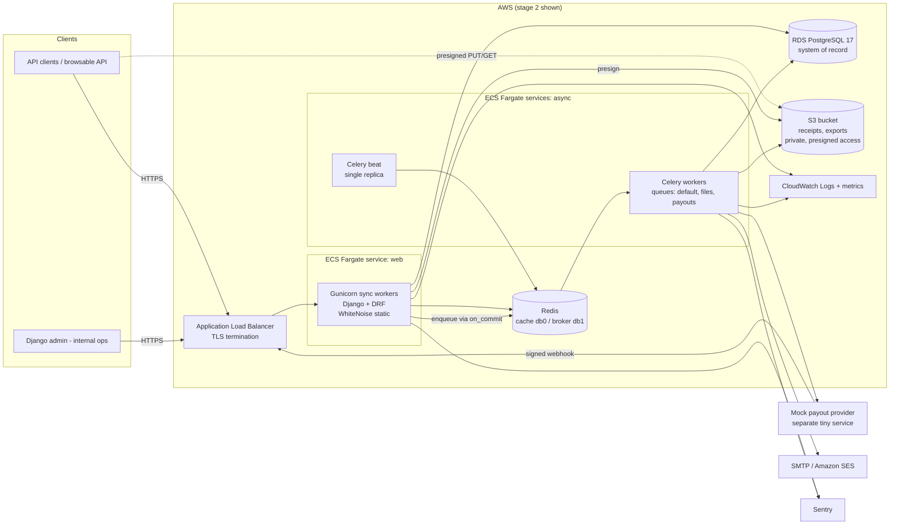
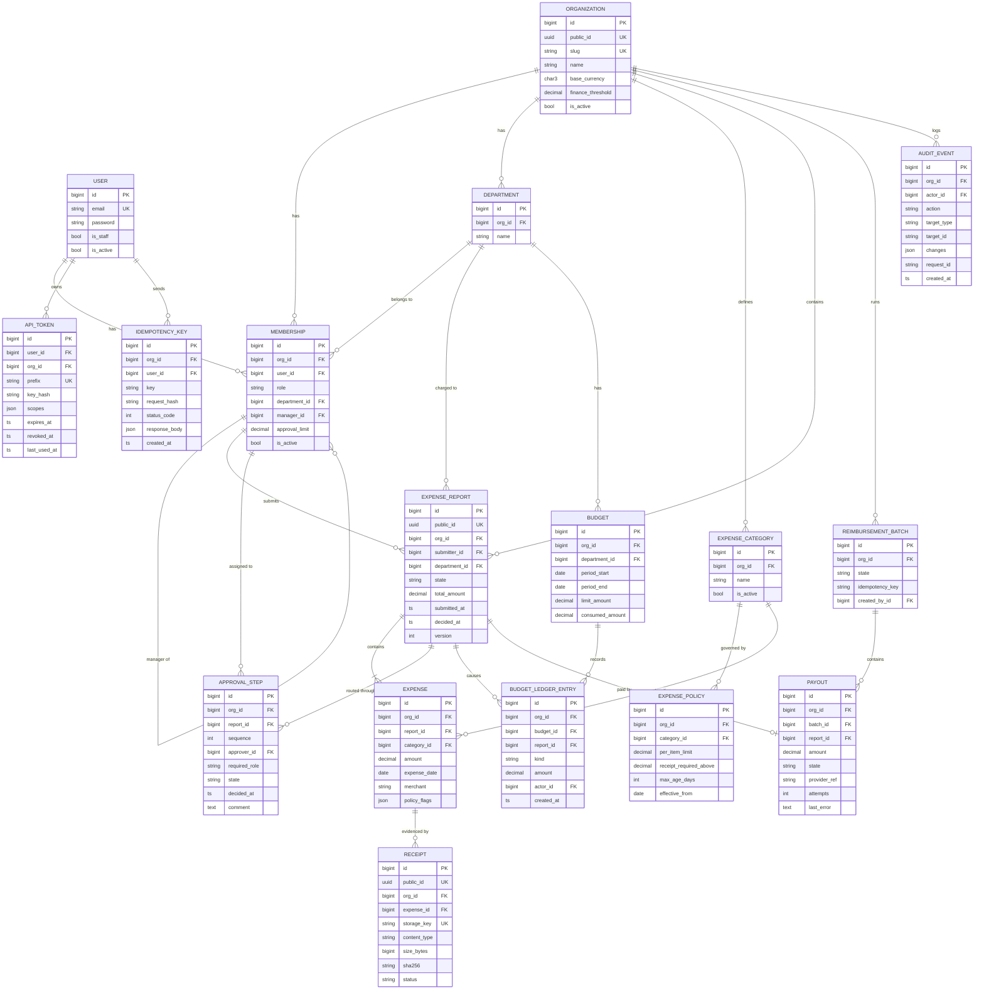

# Parts 7–8: Flagship Project and Complete Technical Design

## Part 7: The recommendation

**Build Kharcha, a multi-tenant Spend & Approval platform.**

### Why this project

**It fits your direction.** You already have FastAPI, Postgres, Redis, Docker and AWS exposure. Kharcha doesn't repeat that work. It adds the parts you haven't done yet:

- multi-actor authorization
- transactional business workflows
- tenant isolation
- the parts of Django that FastAPI leaves to you: ORM depth, migrations, auth, sessions, admin and forms

**It connects to your background.** Mainframe and DB2 work is batch processing, transactional integrity and auditability. Kharcha has all three: reimbursement batches, budget ledgers and audit trails. You get a credible story: "I took the correctness mindset from mainframe finance systems into a modern Django stack."

**It is achievable.** The MVP is about 15 entities and roughly 35 endpoints. The hard parts are deep rather than wide.

### What could go wrong

There are two risks:

- **Feature creep.** Multi-currency, OCR, SSO and mobile apps are all tempting. They are deferred explicitly in §A.6.
- **Sliding into CRUD.** This is prevented by planned engineering challenges in every phase of the [roadmap](05-roadmap.md).

---

## Part 8: Technical design

## A. Product definition

### A.1 Name and one-liner
**Kharcha** is a multi-tenant API platform. Companies use it to collect expense claims, enforce spending policy, route approvals, control departmental budgets and batch reimbursements, with a complete audit trail.

### A.2 Problem statement
Small and mid-size companies run expenses through email, spreadsheets and chat. This causes:

- receipts that are lost or forged
- approvals with no record of who approved what
- managers approving their own claims
- budgets that overspend without anyone noticing
- double reimbursements
- weeks of delay

### A.3 Target customers
Companies with 20 to 2,000 employees and one or more finance staff. Typical examples are Indian startups and SMEs, agencies and distributed teams.

### A.4 Personas

| Persona | Goals | Key powers |
|---|---|---|
| **Employee** | Submit claims quickly and get paid | Create, edit and submit their own reports; upload receipts |
| **Approver (manager)** | Approve their team's claims quickly and safely | Approve or reject steps assigned to them, within their approval limit |
| **Finance admin** | Control spending and pay people | Pooled finance approval step, budgets, reimbursement batches, exports |
| **Org admin** | Set up the company | Members, roles, departments, categories, policies |
| **Platform ops (internal staff)** | Support customers and investigate issues | Django admin with restricted, audited actions |

### A.5 Core use cases (MVP)

1. An org admin creates the org, then invites members with a role, department and manager.
2. An employee creates a draft report and adds expenses (amount, date, category, merchant). They upload receipts directly to object storage.
3. The employee submits the report. The policy engine checks per-item limits, required receipts and age. Approval steps are generated.
4. Approvers see an inbox and approve or reject. Reports over the org's finance threshold get a second, pooled finance step.
5. At final approval, the department's budget for that period is consumed atomically. If the budget would be exceeded, the approval fails with `409 BUDGET_EXCEEDED`.
6. Finance creates a reimbursement batch. Payouts go through a mock provider, with retries and reconciliation.
7. Finance views a spend dashboard (by department, category and month) and exports CSV files.
8. Every state change and admin action is recorded in an audit log.

### A.6 Requirements

**Functional (MVP)**

- **Accounts:** email and password accounts, session login, and personal API tokens.
- **Organizations:** orgs, memberships with roles, departments and a manager chain.
- **Reports:** reports, expenses and receipts with a defined lifecycle.
- **Policy and approvals:** policy evaluation, then multi-step approval routing with approval limits and separation of duties.
- **Money:** budgets with an append-only ledger, and reimbursement batches with payouts.
- **Reporting:** the dashboard, CSV export, the audit log and the admin back-office.

**Non-functional**

| Concern | Target |
|---|---|
| Correctness | No lost updates. No double consumption of budget. No double payout. Each of these has a test. |
| Isolation | No API path returns another tenant's data. This is enforced by scoped querysets and covered by a cross-tenant test matrix. |
| Latency | p95 under 300 ms for the inbox and report detail at 50k reports per tenant. The dashboard is under 500 ms when cold and under 50 ms when cached. |
| Query budget | Every list endpoint uses a constant number of queries, regardless of page size. Tests assert this. |
| Availability | One region. Health and readiness endpoints. Zero-downtime deploys in stage 2. |
| Security | Passes OWASP ASVS L1-style checks. `check --deploy` is clean. Secrets are never in the repo. |
| Observability | JSON logs carrying `request_id`, `org_id` and `user_id`. Errors go to Sentry. Basic CloudWatch metrics. |

**Excluded from v1.** Each item stays deferred until it has a reason to exist:

- multi-currency and FX
- OCR or receipt parsing
- corporate card feeds
- SSO, SAML or OIDC
- a mobile app or SPA frontend
- outbound webhooks (Phase 7)
- Postgres row-level security (Phase 7)
- API versioning beyond `/v1` (Phase 7)
- real-time updates via Channels
- self-serve billing for Kharcha itself

## B. System architecture



| Component | Responsibility | Why it exists |
|---|---|---|
| ALB | Terminates TLS, routes requests, runs health checks | Managed HTTPS and rolling deploys. Nginx isn't needed behind it. |
| Web (Gunicorn + Django) | Handles HTTP requests, authn/authz, validation, short transactions, and enqueuing work | The core application |
| Celery workers | Notifications, receipt processing, exports, payouts | Slow or unreliable work must not hold HTTP workers or transactions open |
| Celery beat | Budget period rollover, stuck-payout reconciliation, idempotency-key cleanup | Scheduled jobs. It must be a **single** replica, or every job runs twice. |
| PostgreSQL | System of record. Enforces constraints. Provides row locks. | Transactions and constraints are the backbone of correctness |
| Redis | Django cache (db0) and Celery broker (db1) | One dependency for the MVP. The ADR notes when to split them. |
| S3 | Receipts and generated exports | Keeps large binaries out of the database and out of web workers |
| Mock payout provider | Simulates a payment provider: slow, flaky, idempotent by key, signed webhooks | Lets us practise retries, timeouts and reconciliation without real money |
| Sentry / CloudWatch | Error reporting, logs and metrics | Production debugging |

**Why sync WSGI.** Request work is short database transactions. Slow I/O (email, the provider, S3 processing) runs in Celery. ASGI would add complexity, because the ORM would mostly run through `sync_to_async`, and nothing in the MVP needs it. See [ADR-0001](adr/0001-modular-monolith.md).

## C. Django project structure

```
kharcha/
  manage.py
  pyproject.toml            # uv-managed
  config/
    __init__.py             # imports celery app
    settings/
      base.py               # everything shared; reads env via a small helper
      dev.py                # DEBUG, debug-toolbar, console email
      test.py               # fast hasher, eager-off, locmem cache
      prod.py               # security headers, S3, JSON logging, Sentry
    urls.py                 # /admin/, /api/v1/, /healthz, /readyz
    wsgi.py
    asgi.py                 # present, unused in MVP
    celery.py
  apps/
    common/                 # base models (TimeStamped, TenantScoped), tenant context, middleware,
                            # exceptions + DRF handler, idempotency, pagination, money helpers
    accounts/               # User, ApiToken, auth backend, DRF token auth, login/logout APIs
    organizations/          # Organization, Membership, Department; roles; invitations
    policies/               # ExpenseCategory, ExpensePolicy; pure policy-evaluation functions
    expenses/               # ExpenseReport, Expense; report state machine
    files/                  # Receipt; storage helpers; presign; validation task
    approvals/              # ApprovalStep; routing; inbox selectors
    budgets/                # Budget, BudgetLedgerEntry; consume/release services
    reimbursements/         # ReimbursementBatch, Payout; provider client; reconciliation
    reporting/              # dashboard selectors, export jobs (no models of its own except ExportJob)
    audit/                  # AuditEvent; record() service; admin signal contrast
  tests/                    # or per-app tests/ — choose one and be consistent (per-app recommended)
  docker/ , compose.yaml , .github/workflows/
```

**Inside each domain app:**

```
expenses/
  models.py        # fields, constraints, indexes, tiny invariant methods (e.g. can_transition_to)
  managers.py      # custom QuerySet / Manager (tenant scoping + named query methods)
  services.py      # WRITE use cases: submit_report(), recall_report() — own the transaction
  selectors.py     # READ use cases: report_detail(), reports_for_member() — own query shape
  policies.py      # authorization predicates: can_view_report(member, report) …
  api/serializers.py, api/views.py, api/urls.py, api/permissions.py
  tasks.py         # Celery tasks — thin wrappers that call services
  admin.py
  migrations/
  tests/
```

**Why this structure** (a recommendation, not dogma):

- **Services own transactions.** A view should never need to know that approving a report also touches budgets, the ledger and the audit log. One function wraps `atomic()` and is testable without HTTP. Views stay thin: parse, authorize, call the service, serialize.
- **Selectors own query shape.** All `select_related`, `Prefetch` and `annotate` calls for a screen live in one place, so N+1 fixes and query-count tests have a single target.
- **Policies are plain functions.** Both DRF permission classes and selectors call them. The inbox *query* and the approve *action* share one definition of "may act on this step", so the two can't drift apart.
- **Models stay small but not anaemic.** Field invariants and simple state predicates belong on the model. Cross-aggregate workflows don't.
- **Trade-off.** This is more files than "fat models + ViewSets". For a 3-model app that would be overkill. Here, the cross-app workflows (approve → budget → ledger → audit → notify) justify it.

**Settings.** `base.py` plus per-environment modules, chosen through `DJANGO_SETTINGS_MODULE`. Secrets come only from environment variables: `.env` locally (git-ignored, with `.env.example` committed), and AWS SSM Parameter Store or Secrets Manager in production.

## D. Database design

### D.1 ER diagram



### D.2 Key decisions and why each is needed

| Decision | Reason |
|---|---|
| **bigint PK, plus a `public_id` UUID** for exposed resources (orgs, reports, receipts) | Bigint keeps indexes compact, and sequential inserts keep B-trees local. Public UUIDs don't reveal volume and can't be enumerated. *Trade-off:* every lookup by `public_id` needs its own unique index. |
| **`org_id` on every tenant-owned table, including child tables** (Expense, Receipt, ApprovalStep) | This is deliberate denormalisation. Scoping becomes a single-column predicate with no joins. Composite indexes can lead with `org_id`. It also enables Postgres RLS later. *Cost:* consistency must be enforced (service sets it from the parent, and a test asserts `child.org_id == parent.org_id`). |
| **Money as `DecimalField(max_digits=14, decimal_places=2)` + org `base_currency`** | Floats cannot represent 0.10 exactly. A single currency per org keeps the MVP honest. Multi-currency would need FX snapshots per expense. |
| **`ExpenseReport.total_amount` stored** (denormalised) | The inbox and dashboard read it constantly. It is recomputed in the same transaction whenever an expense changes, and a test asserts `total == SUM(expenses)`. |
| **`version` int on ExpenseReport** | Optimistic concurrency for edits: `UPDATE … WHERE id=? AND version=?`. If no row is updated, the client gets a `409`. |
| **Append-only `BudgetLedgerEntry` + cached `Budget.consumed_amount`** | The ledger explains every rupee. The cached column makes the "remaining" check O(1) under a row lock. A nightly reconciliation task compares the two. |
| **ApprovalStep rows** (not a JSON array on the report) | Each step is queryable for the inbox, has its own approver FK and index, and has its own state and timestamps for audit. |
| **Payout one-to-one with report** (unique `report_id`) | A report can never be paid twice, and this is guaranteed by the database. |
| **IdempotencyKey table** (not Redis) | The stored response must survive restarts and must be inserted in the *same transaction* as the effect it guards. |
| **AuditEvent with `target_type`/`target_id` strings** (not a GenericForeignKey) | Audit rows must outlive deleted targets. GFKs add `contenttypes` joins and nothing else here. |

### D.3 Constraints

| Table | Constraint | Purpose |
|---|---|---|
| Membership | `UniqueConstraint(org, user)` | One membership per user per org |
| Membership | `CheckConstraint(approval_limit >= 0)` | |
| Membership | `CheckConstraint(~Q(manager=F('id')))` | A member can't be their own manager. Deeper cycles are checked in the service. |
| Department | `UniqueConstraint(org, Lower('name'))` | Case-insensitive unique names (functional unique constraint) |
| ExpenseCategory | `UniqueConstraint(org, Lower('name'))` | |
| Expense | `CheckConstraint(amount > 0)` | |
| ExpenseReport | `CheckConstraint(total_amount >= 0)` | |
| ExpenseReport | `CheckConstraint(state IN (...))` | Django `choices` aren't enforced by the database, so this one is |
| ExpenseReport | `CheckConstraint(Q(state='DRAFT') \| Q(submitted_at__isnull=False))` | Non-draft reports must have a submission time |
| ApprovalStep | `UniqueConstraint(report, sequence)` | |
| ApprovalStep | `UniqueConstraint(report, condition=Q(state='PENDING'), name='one_pending_step_per_report')` | **Partial unique.** At most one open step per report at any time. |
| Budget | `UniqueConstraint(department, period_start)` | One budget per department per period. This also makes beat-driven rollover idempotent. |
| Budget | `CheckConstraint(consumed_amount >= 0)` and `CheckConstraint(consumed_amount <= limit_amount)` | The **last line of defence** against overspending, even if the application logic is wrong |
| BudgetLedgerEntry | `UniqueConstraint(budget, report, kind)` | The same report can't consume the same budget twice |
| Receipt | `UniqueConstraint(storage_key)` | |
| Payout | `UniqueConstraint(report)` | No double payout |
| ReimbursementBatch | `UniqueConstraint(org, idempotency_key)` | |
| IdempotencyKey | `UniqueConstraint(org, user, key)` | |
| ApiToken | `UniqueConstraint(prefix)` | |

### D.4 Indexes (each driven by a query pattern)

| Index | Query it serves |
|---|---|
| `ExpenseReport(org, submitter, -created_at)` | "My reports" list |
| `ExpenseReport(org, state, -submitted_at)` | Finance views by state |
| `ApprovalStep(approver, state)` **partial** `WHERE state='PENDING'` | Approver inbox. It stays small because only pending rows are indexed. |
| `ApprovalStep(org, required_role)` partial `WHERE state='PENDING' AND approver_id IS NULL` | Pooled finance inbox |
| `Expense(org, category, expense_date)` | Dashboard by category and month |
| `BudgetLedgerEntry(budget, created_at)` | Budget history |
| `AuditEvent(org, -created_at)` and `(org, target_type, target_id)` | Audit browsing and per-object history |
| `Payout(state, updated_at)` partial `WHERE state IN ('PENDING','SENT')` | Reconciliation sweep |
| `IdempotencyKey(created_at)` | Cleanup job |

Each index is *proved* in Phase 5 with `EXPLAIN (ANALYZE, BUFFERS)` on seeded data: 50k reports, 200k expenses, 20 tenants, one of them "noisy". Indexes that no query uses get removed.

### D.5 Transaction boundaries

| Use case (service) | Inside one `atomic()` | Locking strategy | After commit (`on_commit`) |
|---|---|---|---|
| `submit_report` | Validate policy, set state to SUBMITTED, create step 1, write IdempotencyKey response, write audit row | Conditional update: `UPDATE report SET state='SUBMITTED' WHERE id=? AND state='DRAFT' AND version=?` | Notify approver |
| `approve_step` (not final) | Mark the step APPROVED (conditional on PENDING), create the next step, audit | Conditional update on the step row | Notify next approver |
| `approve_step` (final) | Mark the step APPROVED, set report to APPROVED, **lock the Budget row** (`select_for_update`), check remaining, `F()` increment, insert ledger entry, audit | Report and step: conditional update. Budget: pessimistic lock, because it is a hot shared row | Notify submitter |
| `reject_step` | Step REJECTED, report REJECTED, audit | Conditional | Notify submitter |
| `create_reimbursement_batch` | Select APPROVED reports with no payout using `select_for_update(skip_locked=True)`, create the batch and payouts, set reports to REIMBURSING | `skip_locked`, so two finance admins don't fight over the same reports | Enqueue one payout task per payout |
| `process_payout` (task) | **No transaction around the HTTP call.** Transaction 1: mark SENDING with attempts+1. Then the HTTP call. Transaction 2: record the result. | Row lock on the payout only within the short transactions | Retry with backoff on transient errors |
| `confirm_receipt_upload` | Set Receipt to UPLOADED | — | Enqueue validation |

Rule: **never hold a database transaction open across network I/O.** HTTP calls, S3 calls and emails happen outside `atomic()`.

## E. API design

### E.1 Conventions

- **Base URL:** `/api/v1/`. Tenant routes are nested under `/api/v1/orgs/{org_slug}/`.
- **Authentication:** DRF `SessionAuthentication` (with CSRF) for first-party clients and the browsable API. `TokenAuthentication` uses a custom class: header `Authorization: Bearer kh_<prefix>_<secret>`.
- **Cross-tenant access:** returns **404, not 403**, so the API doesn't reveal that a resource exists in another org.
- **Errors:** every error uses one envelope:

  ```json
  {"error": {"code": "BUDGET_EXCEEDED", "message": "Department budget for 2026-11 has ₹4,200.00 remaining; report total is ₹6,000.00.", "details": {}, "request_id": "01JD…"}}
  ```

- **Status codes:**

  | Code | Meaning |
  |---|---|
  | 400 | Validation error |
  | 401 | Unauthenticated |
  | 403 | Authenticated but not allowed, for resources the caller is allowed to *see* |
  | 404 | Not found, or another tenant's resource |
  | 409 | Illegal state transition, stale version, or idempotency-key conflict |
  | 413 | Payload too large |
  | 429 | Throttled |
  | 202 | Async job accepted |

- **Pagination:** cursor (keyset) pagination for large lists (inbox, reports, audit). Page-number pagination for small admin lists.
- **Idempotency:** the `Idempotency-Key` header is **required** on `POST …/submit/`, `…/approve/`, `…/reject/` and `/reimbursement-batches/`:
  - Same key + same body: the stored response is replayed.
  - Same key + different body: `409 IDEMPOTENCY_KEY_REUSED`.
- **Concurrency on edits:** `PATCH` requires `If-Match: <version>`, or `version` in the body. A stale version returns `409 STALE_VERSION`.
- **Documentation:** OpenAPI 3 via drf-spectacular at `/api/schema/`, with Swagger UI in non-production environments.

### E.2 Endpoint catalogue

| Method | URL | Purpose | AuthN | AuthZ |
|---|---|---|---|---|
| GET | `/api/v1/auth/csrf/` | Set the CSRF cookie | none | — |
| POST | `/api/v1/auth/login/` | Session login | none | — |
| POST | `/api/v1/auth/logout/` | Session logout | session | — |
| GET | `/api/v1/me/` | Current user and memberships | any | — |
| GET/POST | `/api/v1/me/tokens/` | List or create API tokens. The secret is shown **once**. | session only | own |
| DELETE | `/api/v1/me/tokens/{id}/` | Revoke a token | session only | own |
| GET | `/api/v1/orgs/` | Orgs I belong to | any | — |
| GET/PATCH | `/api/v1/orgs/{slug}/` | Org settings | any | member / org admin |
| GET/POST | `/api/v1/orgs/{slug}/members/` | List or invite members | any | admin (POST), member (GET, limited fields) |
| PATCH | `/api/v1/orgs/{slug}/members/{id}/` | Change role, department, manager or limit | any | org admin; cannot demote the last admin |
| GET/POST | `/api/v1/orgs/{slug}/departments/` | Departments | any | admin (write) |
| GET/POST | `/api/v1/orgs/{slug}/categories/`, `/policies/` | Categories and policies | any | admin (write) |
| GET/POST | `/api/v1/orgs/{slug}/reports/` | My reports (finance sees all), or create a draft | any | member |
| GET/PATCH/DELETE | `/api/v1/orgs/{slug}/reports/{public_id}/` | View, edit or delete a draft | any | view: submitter, assigned approvers, finance. Edit/delete: submitter while DRAFT. |
| POST | `/…/reports/{id}/expenses/` · PATCH/DELETE `/…/expenses/{eid}/` | Manage line items | any | submitter, while DRAFT |
| POST | `/…/reports/{id}/submit/` | Submit | any | submitter |
| POST | `/…/reports/{id}/recall/` | Withdraw to DRAFT before any decision | any | submitter |
| POST | `/…/expenses/{eid}/receipts/` | Create a Receipt and return a presigned POST | any | submitter, while DRAFT |
| POST | `/…/receipts/{rid}/confirm/` | Mark uploaded and enqueue validation | any | uploader |
| GET | `/…/receipts/{rid}/download/` | Return a 60-second presigned GET | any | anyone who can view the report |
| GET | `/…/approvals/inbox/` | Pending steps I can act on | any | approver / finance |
| POST | `/…/approvals/{step_id}/approve/` · `/reject/` | Decide a step | any | policy `can_decide_step` |
| GET/POST | `/…/budgets/` · GET `/…/budgets/{id}/ledger/` | Budgets and their history | any | finance / admin |
| POST | `/…/budgets/{id}/adjustments/` | Raise or lower a limit (ledger ADJUST) | any | finance |
| POST | `/…/reimbursement-batches/` · GET `/{id}/` | Create or view a batch | any | finance |
| GET | `/…/dashboard/spend/?from=&to=&group_by=department\|category\|month` | Aggregates | any | finance / admin |
| POST | `/…/exports/` · GET `/…/exports/{id}/` | Async CSV export (202) and status/download | any | finance |
| GET | `/…/audit-events/?target_type=&target_id=` | Audit log | any | admin / finance |
| POST | `/api/v1/webhooks/payout-provider/` | Payout status callback | HMAC signature | provider |
| GET | `/healthz` · `/readyz` | Liveness and readiness | none | — |

### E.3 Detailed contracts for critical endpoints

#### `POST /api/v1/orgs/{slug}/reports/{id}/submit/`

- **AuthN:** session (with CSRF) or bearer token with scope `reports:write`.
- **AuthZ:** the caller must be the report's submitter and an active member of the org.
- **Headers:** `Idempotency-Key` (required, 8–64 characters). `If-Match: <version>` (required).
- **Request body:** `{"justification": "optional, required if policy flags exist"}`.
- **Validation:**
  - state is DRAFT
  - at least 1 expense
  - every expense above `receipt_required_above` has a CLEAN or UPLOADED receipt
  - no expense older than `max_age_days`
  - per-item limit violations require a justification
  - the department has a manager-chain approver who is not the submitter
- **200 response:** `{"id","state":"SUBMITTED","version","total_amount","approval_steps":[{"sequence":1,"approver":{…},"state":"PENDING"}]}`.
- **Errors:**

  | Status | Code |
  |---|---|
  | 400 | `POLICY_VIOLATION` (with per-expense details) |
  | 400 | `RECEIPT_MISSING` |
  | 400 | `NO_APPROVER_AVAILABLE` |
  | 404 | not visible |
  | 409 | `INVALID_STATE` |
  | 409 | `STALE_VERSION` |
  | 409 | `IDEMPOTENCY_KEY_REUSED` |
  | 428 | missing `If-Match` |

#### `POST /api/v1/orgs/{slug}/approvals/{step_id}/approve/`

- **AuthZ** (`can_decide_step`):
  - the step is PENDING
  - the caller is the assigned approver, or (for a pooled step) holds `required_role`
  - the caller is **not** the submitter (separation of duties)
  - the caller's `approval_limit >= report.total_amount`, otherwise `403 APPROVAL_LIMIT_EXCEEDED`
- **Request body:** `{"comment": "optional, ≤ 2000 chars"}`.
- **200 response:** the report summary, including the new state and the next step if one exists.
- **Errors:**

  | Status | Code |
  |---|---|
  | 403 | `APPROVAL_LIMIT_EXCEEDED` |
  | 403 | `SELF_APPROVAL_FORBIDDEN` |
  | 404 | not visible |
  | 409 | `STEP_ALREADY_DECIDED` (lost the race) |
  | 409 | `BUDGET_EXCEEDED` (final step only) |
  | 409 | `IDEMPOTENCY_KEY_REUSED` |

#### `POST /…/expenses/{eid}/receipts/`

- **Request body:** `{"filename": "uber.pdf", "content_type": "application/pdf", "size_bytes": 182334, "sha256": "…"}`.
- **Validation:**
  - `content_type` must be one of `image/jpeg`, `image/png` or `application/pdf`
  - `size_bytes` must be 10 MB or less
  - at most 5 receipts per expense
- **201 response:** `{"receipt_id", "upload": {"url", "fields": {…}}, "expires_in": 300}`. The presigned POST policy has a `content-length-range` condition and an exact `Content-Type` condition. The key is generated by the server: `org/<org_public_id>/receipts/<uuid>`.
- **What happens after upload.** `confirm` triggers a task that:
  1. Downloads the object.
  2. Checks the magic bytes against the declared type.
  3. Checks the size.
  4. Computes SHA-256 and compares it with the client's value.
  5. Optionally runs a ClamAV scan (Phase 7).
  6. Generates a thumbnail.
  7. Sets status to CLEAN or REJECTED.

  A REJECTED receipt is deleted from S3.

#### `GET /…/dashboard/spend/`

- **Query parameters:** `from`, `to` (ISO dates, at most a 24-month range), `group_by` in `{department, category, month}`.
- **200 response:** `{"currency":"INR","group_by":"department","rows":[{"key","label","approved_total","pending_total","report_count","budget_limit","budget_consumed"}],"generated_at","cache":"hit|miss"}`.
- **Performance contract:**
  - at most 3 queries
  - cached per `(org, params, org_data_version)`
  - the version is bumped on commit by any service that changes approved totals

### E.4 Serializer and validation layering

| Layer | Examples |
|---|---|
| Serializer | Types, formats, required fields, and simple cross-field rules (`expense_date <= today`) |
| Service | Rules that need database state: budget remaining, approver resolution, state transitions |
| Database | The final guarantees listed in D.3 |

`IntegrityError` from known constraints is caught in the service and mapped to domain errors. For example, `one_pending_step_per_report` maps to `STEP_ALREADY_DECIDED`.

## F. Technology stack

| Area | Choice | Why needed / problem solved | Built-in alternative | When | Understand first |
|---|---|---|---|---|---|
| Language | Python 3.13 | Supported by Django 6.1. Mature wheels for every dependency. | — | MVP | — |
| Framework | **Django 6.1.x** (6.1.3 on PyPI, Nov 2026) | Current feature release. Fetch modes help with N+1. | — | MVP | Release and support policy ([ADR-0002](adr/0002-django-version.md)) |
| API | **DRF 3.18.x** (declares Django 6.1 support on PyPI) | Serializers, auth and permission classes, throttling, browsable API | Plain Django views + `JsonResponse` (more work, but instructive; do one endpoint this way in Phase 1) | MVP | `APIView.dispatch` → `initial()` → authenticate/permissions/throttles |
| API docs | drf-spectacular | OpenAPI 3 from code | — | Phase 1 | Schema generation. **Check** that its Django 6.1 support is declared at install time (PyPI classifiers listed up to 6.0 as of 2026-11-26). |
| Database | PostgreSQL 17 | Constraints, partial indexes, `SELECT … FOR UPDATE SKIP LOCKED`, functional indexes | SQLite (no row locks or skip_locked, so unsuitable) | MVP | MVCC, isolation levels, lock types |
| Cache | Redis via `django.core.cache.backends.redis.RedisCache` | Shared cache across processes | LocMem (per-process, so wrong in production), DB cache | Phase 4 | Eviction policy, key namespacing |
| Background | **Celery 5.x** + Redis broker | Retries, backoff, routing, beat, mature operational tooling | Django 6 `django.tasks` defines and enqueues tasks but ships **no production worker** ([ADR-0004](adr/0004-celery-vs-django-tasks.md)) | Phase 4 | At-least-once delivery, `acks_late`, visibility timeout |
| Real-time | **Not used** (Channels) | No requirement in the MVP | — | Never, unless a live inbox is required | — |
| Files | django-storages (S3) + boto3 presigning; MinIO locally | Private object storage with direct uploads | `FileSystemStorage` (dev only) | Phase 4 | Storage API, presigned POST policies |
| Auth | Django auth + sessions + custom hashed tokens | First-party sessions; tokens for integrations | DRF's `authtoken` stores keys in plaintext, so we don't use it ([ADR-0005](adr/0005-api-auth-strategy.md)) | Phase 3 | Backends, session lifecycle, CSRF |
| Testing | pytest-django, factory_boy, time-machine, Locust | Fixtures, factories, time control, load | Django `TestCase` (still used underneath) | Phase 1 onward | `TestCase` vs `TransactionTestCase` |
| Profiling | django-debug-toolbar (dev), `EXPLAIN ANALYZE`, `connection.queries`, py-spy | Finding slow queries and hot code | — | Phase 2/5 | — |
| Packaging and lint | uv, ruff, pre-commit; mypy + django-stubs optional | Fast, reproducible installs | — | Phase 1 | — |
| Container | Docker, multi-stage, non-root | Same artefact in every environment | — | Phase 1 (compose), Phase 6 (prod image) | Layers, build cache |
| App server | Gunicorn sync workers; WhiteNoise for static | Pre-fork WSGI with predictable concurrency | `runserver` (dev only) | Phase 6 | Worker model, timeouts, `--max-requests` |
| Reverse proxy | **None** behind ALB. Nginx only in stage 1 (EC2). | TLS, buffering slow clients | — | Phase 6 | Proxy headers, `SECURE_PROXY_SSL_HEADER` |
| Cloud | AWS: stage 1 EC2 + RDS + S3; stage 2 ECS Fargate + ALB + ECR | Matches what you are learning | — | Phase 6 | VPC, security groups, IAM roles |
| CI/CD | GitHub Actions | Lint, test with Postgres/Redis services, build, push, deploy | — | Phase 1 (CI), Phase 6 (CD) | — |
| Monitoring | structlog JSON logs, Sentry, CloudWatch | Correlated debugging | Django `logging` config (used underneath) | Phase 6 | Log levels, PII scrubbing |

Exact versions are pinned in `uv.lock` at setup time. They were verified on PyPI on 2026-11-26: Django 6.1.3, DRF 3.18.3, Celery 5.7.0, django-storages 1.14.6, pytest-django 4.14.0, drf-spectacular 0.30.0.
