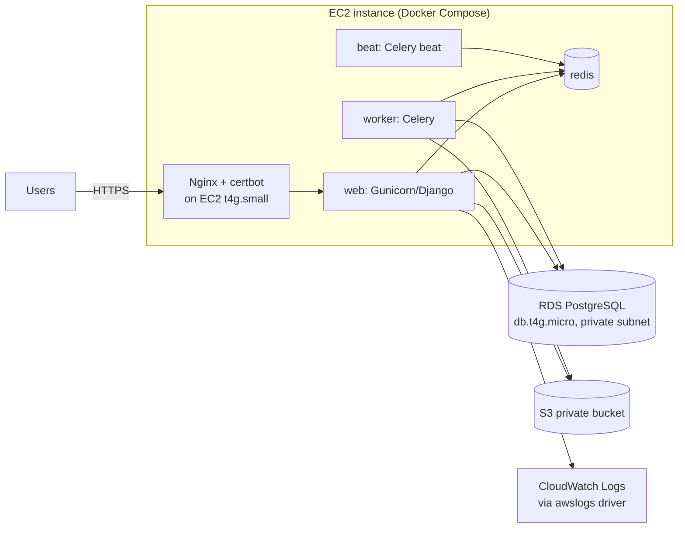
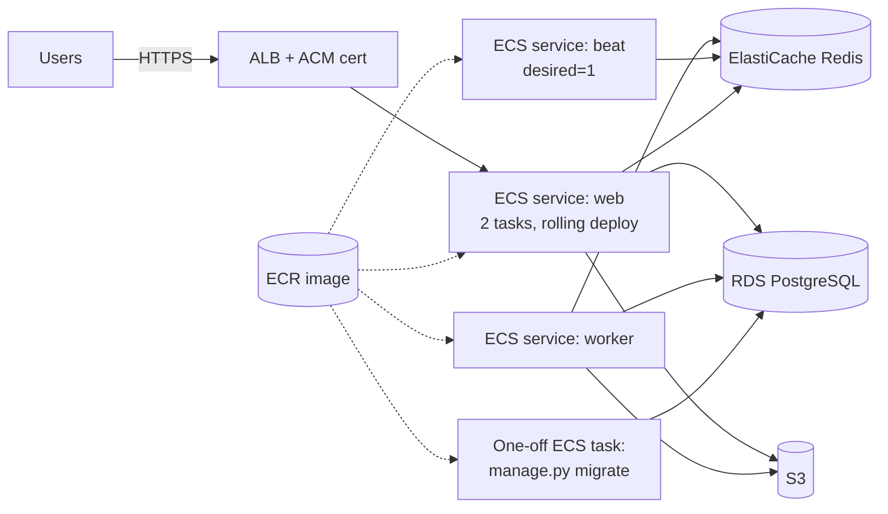

# Part 12: Deployment and Operations

## 1. Local development vs. production

| Concern | Local | Production |
|---|---|---|
| Settings | `config.settings.dev`, `.env` | `config.settings.prod`. Environment comes from SSM Parameter Store or Secrets Manager. |
| `DEBUG` | True | **False** (otherwise you leak tracebacks and settings, and memory grows because of `connection.queries`) |
| Web server | `runserver` (single process, autoreload) | Gunicorn: `--workers 2–4`, `--timeout 30`, `--max-requests 1000 --max-requests-jitter 100`, `--access-logfile -` |
| Static files | `runserver` serves them | `collectstatic` at image build time, served by WhiteNoise with compressed, hashed filenames |
| Media / receipts | MinIO in Compose | S3 private bucket, presigned URLs, SSE-S3 encryption, lifecycle rule for REJECTED and orphan uploads |
| Database | Postgres container | RDS PostgreSQL 17, automated backups, `CONN_MAX_AGE=60`, `CONN_HEALTH_CHECKS=True` |
| Cache / broker | Redis container | Stage 1: Redis on the EC2 instance (Docker). Stage 2: ElastiCache, or Redis in a Fargate task for cost |
| Email | Console backend | Amazon SES (SMTP) |
| HTTPS | None | TLS terminates at Nginx (stage 1, Let's Encrypt) or at the ALB (stage 2, ACM). Set `SECURE_PROXY_SSL_HEADER=("HTTP_X_FORWARDED_PROTO","https")` |
| Hosts | `localhost` | Explicit `ALLOWED_HOSTS`, plus `CSRF_TRUSTED_ORIGINS=["https://api.<domain>"]` |
| Errors | Console | Sentry (free tier), with PII scrubbing |
| Logs | Pretty console | JSON to stdout, collected into CloudWatch Logs |

## 2. WSGI vs ASGI

**Decision: WSGI with Gunicorn sync workers.**

- **Why it's enough.** Requests are short database transactions. Slow I/O goes to Celery. A sync worker handles one request at a time, which is predictable and easy to reason about. It also keeps database connection usage easy to calculate.
- **When to switch to ASGI** (Uvicorn workers):
  - you need WebSockets or SSE (for example, a live inbox), or
  - many views end up waiting on outbound HTTP.

  Even then, Django's ORM runs in a thread pool under ASGI, so the gain is limited for database-bound code.

## 3. Stage 1: affordable AWS deployment

**Setup**

- An instance profile (IAM role) grants S3 access. No access keys live on the box.
- RDS is reachable only from the EC2 security group.
- Port 22 is closed. Use SSM Session Manager instead.

**Cost:** AWS pricing changes, so check the AWS Pricing Calculator for exact numbers. Free-tier eligibility depends on your account age. Stop the instances when you are not demoing.

## 4. Stage 2: ECS Fargate (matches what you are learning)

**Design notes**

- **One image, three commands.** The same image runs `gunicorn`, `celery worker`, and `celery beat`. This guarantees the web and worker code never drift apart.
- **Migrations run as a separate one-off task before the service update, never in the container entrypoint.** If they ran in the entrypoint, two tasks starting at once would race to migrate.
- **ALB health check hits `/healthz`.** It is cheap and makes no database call, so a database blip doesn't cause all tasks to be killed. `/readyz` checks the database and Redis, and is used for deploy verification.
- **Beat must stay at exactly one task** (`desired_count=1`). Rolling deploys can overlap old and new tasks briefly. Scheduled jobs are idempotent (see ADR-0004), so the overlap is harmless.
- **Secrets** come from the task definition `secrets:` block, which reads from SSM or Secrets Manager. Logs go through the `awslogs` driver.
- **Cost.** The ALB and NAT gateway have fixed monthly costs. Avoid the NAT gateway by using public subnets with tightly scoped security groups, or VPC endpoints. Tear the stack down when you are not using it.

## 5. Database migrations in production

**Rule:** every deployment must be safe to run while the previous version is still serving traffic. This is the "expand, then contract" pattern.

1. **Expand.** Add nullable columns and new tables. Create indexes with `AddIndexConcurrently` (set `atomic = False`).
2. Deploy code that writes to both the old and new structure and can read either.
3. Backfill in batches, using a management command or task. Do not use a migration for large tables.
4. **Contract.** Add NOT NULL or constraints (`NOT VALID` then `VALIDATE` in raw SQL for big tables), and remove the old columns, in a *later* deploy.

**Rollback.** Revert the code by redeploying the previous image tag. Database changes are forward-only in production. Because of the expand/contract pattern, the old code still works against the new schema.

## 6. CI/CD (GitHub Actions)

| Workflow | Trigger | Steps |
|---|---|---|
| `ci.yml` | PR, push to main | uv sync → ruff → `makemigrations --check` → pytest (Postgres 17 and Redis service containers, MinIO) → `check --deploy` with prod settings → `pip-audit` → gitleaks |
| `build.yml` | push to main | Build a multi-stage image (non-root user, `collectstatic` at build time) → tag it with the git SHA → push to ECR (OIDC role, no stored AWS keys) |
| `deploy.yml` | manual or tag | Run the migrate task → update the web, worker, and beat services to the new image → wait for stable → smoke-test `/readyz` → on failure, redeploy the previous tag |

## 7. Observability

- **Logs.** JSON lines carrying `timestamp`, `level`, `logger`, `request_id`, `org_id`, `user_id`, `path`, `status`, and `duration_ms`. Celery tasks log `task_id` and the `request_id` that was passed along from the request that enqueued them.
- **Errors.** Sentry SDK with the Django and Celery integrations, `send_default_pii=False`, plus a custom `before_send` scrubber. Tag each event with the release (git SHA).
- **Metrics (start small).**
  - CloudWatch: ALB 5xx count and target response time, RDS CPU, connections, and free storage.
  - A custom metric for the depth of the Celery queue (polled by beat), and the age of the oldest pending payout.
- **Alarms.** 5xx rate above 2% for 5 minutes. RDS connections above 80% of max. Payouts stuck in SENT for more than 30 minutes.
- **Health endpoints.** `/healthz` for liveness (always 200 if the process is alive). `/readyz` for readiness (database `SELECT 1` and Redis `PING`, each with a timeout).

## 8. Backups and recovery

- RDS automated backups with 7-day retention and point-in-time recovery.
- Before risky migrations, take a manual snapshot.
- **Restore drill (do it once and write it up).** Restore to a new instance, point a staging stack at it, and confirm that `reconcile_budget` reports zero drift.
- Enable S3 versioning on the receipts bucket. A lifecycle rule expires noncurrent versions after 30 days.

## 9. Runbook (to write in Phase 6)

The runbook should cover these procedures:

- deploy
- roll back
- run a one-off management command on ECS
- rotate `SECRET_KEY`, using `SECRET_KEY_FALLBACKS` so existing sessions survive
- rotate database credentials
- drain and restart workers
- replay failed payouts
- respond to a suspected cross-tenant leak (disable the affected endpoint, audit query, notify)
